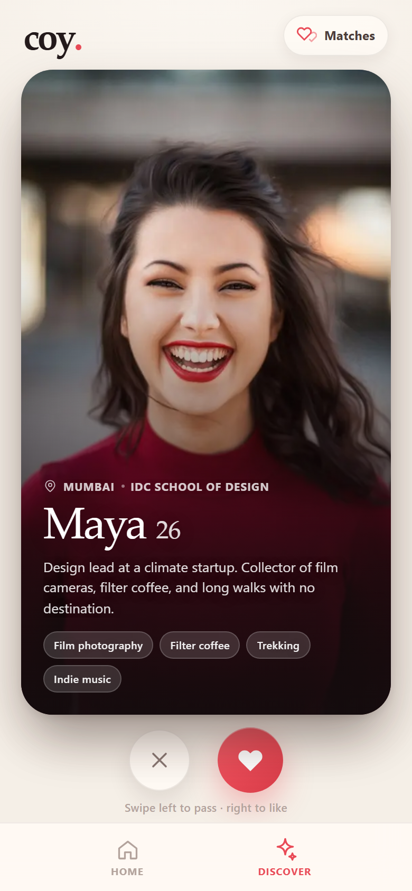
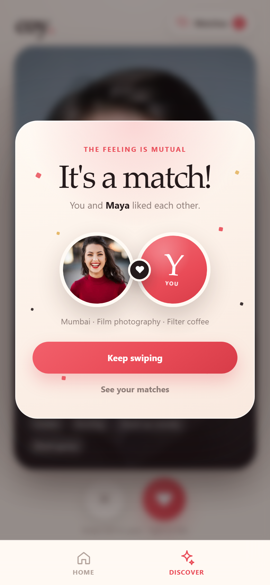
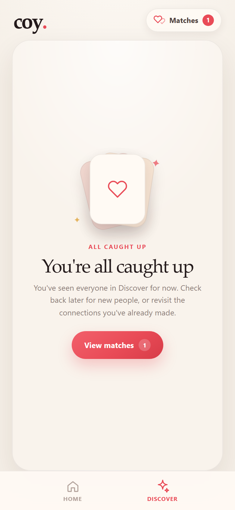

# Coy SDE Intern Assignment

This repository contains both parts of the assignment:

- **Task 1 (Part A):** Two core feature suggestions for Coy, with the reasoning behind each.
- **Task 2 (Part B):** A working, mobile-first **Discover** tab built with Next.js.

## Contents

- [Task 1 — Suggested Core Features](#task-1--suggested-core-features)
  - [Feature 1: Consent-first private chat after a mutual match](#feature-1-consent-first-private-chat-after-a-mutual-match)
  - [Feature 2: Pre-match block list + silent safety controls](#feature-2-pre-match-block-list--silent-safety-controls)
- [Task 2 — Build the Discover Tab](#task-2--build-the-discover-tab)
  - [2.1 Project structure](#21-project-structure)
  - [2.2 How to run](#22-how-to-run)
  - [2.3 Demo walkthrough](#23-demo-walkthrough)
  - [2.4 Features](#24-features)
  - [2.5 Tech stack](#25-tech-stack)
  - [2.6 Backend API](#26-backend-api)
  - [2.7 Matching and privacy](#27-matching-and-privacy)
  - [2.8 Persistence](#28-persistence)
  - [2.9 Implementation notes](#29-implementation-notes)
  - [2.10 Checks performed](#210-checks-performed)

---

## Task 1 — Suggested Core Features

Coy is a **double-blind crush-matching app**, not a browsing or dating-profile app. Its core promise is:

> You add people you already know. They get an anonymous heads-up. You only find out they like you back if they add you too.

Based on that model, these are the two features I would prioritise.

### Feature 1: Consent-first private chat after a mutual match

**What it is:**  
When two people match, give them a private in-app conversation instead of immediately sending them to WhatsApp. Contact details stay hidden by default, and either person can choose to share their phone/email only after an explicit consent step.

**Why it is required:**

- The current “Say hi on WhatsApp” flow exposes a personal phone number and moves the relationship off-platform immediately.
- Some users will be uncomfortable sharing their number with an acquaintance, colleague, or ex — even after a match.
- In-app chat gives Coy a way to add **block, report, and unmatch** controls, which is impossible once the conversation moves to WhatsApp.
- The match moment is the highest-intent moment in the product. Losing users to WhatsApp means Coy gets no retention, moderation, or safety layer.
- This does **not** break Coy’s “no chat” promise: chat remains locked until both people have mutually added each other. No unsolicited messages, no profiles, no discovery.

**Suggested MVP:**

- Chat unlocked only after a mutual match.
- “Share contact” action requiring both people to accept.
- Report / block / unmatch.
- No photos or media initially — keep it text-only and privacy-first.

### Feature 2: Pre-match block list + silent safety controls

**What it is:**  
A private “People I don’t want to match with” list, using phone numbers or emails. If a blocked person adds the user, the match is silently prevented. Neither side is told that a block exists. Also add post-match **Report / Unmatch / Hide my contact** controls.

**Why it is required:**

- Coy is built around people you already know. That makes unwanted matches more likely — an ex, a colleague, a persistent acquaintance, or someone who makes the user uncomfortable.
- “Adding is final” is good for preventing probing, but it also means a user cannot undo or prevent a match with the wrong person.
- A bad match can expose contact details, which is exactly the kind of privacy failure Coy cannot afford.
- A silent block list protects users without leaking any information and without revealing who liked whom.
- This is a core trust feature, not just a settings page. Coy’s entire value proposition depends on users feeling safe enough to add real people.

**Suggested MVP:**

- Block by phone number or email.
- Blocked contacts are matched as invalid; no notification to either person.
- Post-match “Unmatch and hide my contact” action.
- Report flow with a safety review queue.

### Why these two work together

Feature 1 gives matched users a **safe place to talk**.  
Feature 2 prevents the **wrong person from ever reaching that place**.

That combination strengthens Coy’s core promise: *you only find out when it’s mutual, and you stay in control of what happens next.*

> An alternative to Feature 2, if a more growth-oriented feature is preferred: an **anonymous context note** revealed only on mutual match (for example, “We met at the pottery class”). It gives the match a natural conversation starter without breaking the double-blind model.

---

## Task 2 — Build the Discover Tab

A mobile-first, swipe-based **Discover** tab built for Part B of the assignment. It includes a deliberately blank **Home** tab, a working discovery feed, mutual matching, a matches list, and a JSON-backed API that persists across reloads.

### 2.1 Project structure

```text
second_assignment/
│
├── app/
│   ├── api/
│   │   ├── feed/route.ts        GET /api/feed  — unswiped profiles
│   │   ├── swipe/route.ts       POST /api/swipe — record like/pass
│   │   └── matches/route.ts     GET /api/matches — mutual matches
│   │
│   ├── globals.css              Complete mobile-first styling
│   ├── icon.svg                 App favicon
│   ├── layout.tsx               Root layout and metadata
│   └── page.tsx                 Renders the app shell
│
├── components/
│   ├── AppShell.tsx             Home + Discover tab bar
│   ├── Discover.tsx             Feed loading, swipe orchestration, empty/error states
│   ├── SwipeCard.tsx            Drag gesture, card stack, LIKE/PASS stamps
│   ├── MatchModal.tsx           “It’s a match!” screen
│   ├── MatchesSheet.tsx         Mutual matches list
│   └── icons.tsx                Inline SVG icons
│
├── data/
│   ├── profiles.json            37 seeded profiles (read-only seed data)
│   └── db.json                  Runtime swipes/matches (created automatically, gitignored)
│
├── lib/
│   ├── store.ts                 Feed, matching, persistence, privacy filtering
│   └── types.ts                 Shared TypeScript types
│
├── public/
│   └── profiles/                37 local placeholder portraits
│
├── docs/screenshots/            README screenshots
├── next.config.ts               API path aliases (/feed, /swipe, /matches)
├── package.json
├── tsconfig.json
└── README.md
```

#### Request flow

```text
React components
      │
      ▼
Next.js API routes  (/api/feed, /api/swipe, /api/matches)
      │
      ▼
lib/store.ts  (validation, matching, privacy filtering)
      │
      ▼
data/db.json  (swipes + matches)
```

`data/profiles.json` is the fixed seed data. `data/db.json` is mutable runtime data and is never committed.

### 2.2 How to run

#### Requirements

- **Node.js 20.9 or newer**
- **npm**

Check your versions:

```bash
node --version
npm --version
```

#### Development

From the project folder:

```bash
cd C:\Users\DELL\Downloads\second_assignment
npm install
npm run dev
```

Open **http://localhost:3000**.

The first time you run the app, `data/db.json` does not exist. It is created automatically on the first swipe.

#### Production

```bash
npm run build
npm start
```

Then open **http://localhost:3000**.

#### Other commands

```bash
npm run typecheck   # TypeScript check
```

#### Windows PowerShell troubleshooting

If PowerShell reports:

```text
npm.ps1 cannot be loaded because running scripts is disabled on this system
```

use `npm.cmd`:

```powershell
npm.cmd install
npm.cmd run dev
```

Or allow scripts for the current terminal only:

```powershell
Set-ExecutionPolicy -Scope Process -ExecutionPolicy Bypass
```

Then regular `npm` commands work in that same window.

If port `3000` is already in use:

```bash
npm run dev -- -p 3001
```

#### Reset the demo

Stop the server and delete the runtime store:

```powershell
Remove-Item data\db.json
```

On macOS/Linux:

```bash
rm data/db.json
```

Start the app again for a fresh feed.

### 2.3 Demo walkthrough

1. Open **Discover**. The first card is **Maya**.
2. Swipe right, press the heart button, or press `→`. Maya is one of the seeded profiles who already likes the user, so the **“It’s a match!”** screen appears.
3. Press **Keep swiping** and pass the next profile with the pass button, `←`, or a left drag. A toast confirms the action.
4. Open **Matches** in the top-right corner to see the mutual match.
5. Reload the page. Swiped profiles stay gone and the match is still listed.
6. Keep swiping through all profiles to see the empty state. The **Home** tab remains intentionally blank with only the tab bar.

#### Screens

<p align="center">
  
  
  <br />
  
  
</p>

### 2.4 Features

- **37 seeded profiles** with name, age, photo, bio, city, college, and interests.
- **10 profiles already like the user**, allowing mutual matches during a demo.
- **Swipe gestures** on touch devices, mouse dragging on desktop, and pass/like buttons.
- **Keyboard support** with `←` to pass and `→` to like.
- **Live feedback** while dragging with `LIKE` / `PASS` stamps, animated card exits, and confirmation toasts.
- **Mutual matching only** — the “It’s a match!” screen appears only when both sides like each other.
- **Matches view** listing all mutual matches and when they matched.
- **No repeats** — a swiped profile never appears in the feed again.
- **Persistence** — swipes and matches survive reloads and server restarts.
- **Clear empty state** when all profiles have been seen.
- **Privacy by construction** — the `likedYou` seed flag is stripped server-side and never sent to the client.

### 2.5 Tech stack

| Layer | Choice |
| --- | --- |
| Frontend | Next.js 16 (App Router), React 19, TypeScript, plain CSS |
| Backend | Next.js Route Handlers (Node.js runtime) |
| Data | JSON file store with serialized writes |
| Images | Local placeholder portraits in `public/profiles` (Unsplash) |

No external auth, database, or third-party service is required. Portraits are stored locally, so the demo works offline.

### 2.6 Backend API

Both the conventional `/api/*` routes and the exact paths named in the assignment are available.

| Assignment path | Next.js route | Method | Purpose |
| --- | --- | --- | --- |
| `/feed` | `/api/feed` | `GET` | Profiles not yet swiped on |
| `/swipe` | `/api/swipe` | `POST` | Record a like or pass |
| `/matches` | `/api/matches` | `GET` | Mutual matches |

#### `GET /api/feed`

```json
{
  "profiles": [
    {
      "id": "maya",
      "name": "Maya",
      "age": 26,
      "photo": "/profiles/01-maya.jpg",
      "city": "Mumbai",
      "college": "IDC School of Design",
      "bio": "Design lead at a climate startup...",
      "interests": ["Film photography", "Filter coffee", "Trekking", "Indie music"]
    }
  ],
  "remaining": 37
}
```

#### `POST /api/swipe`

Request:

```json
{ "profileId": "maya", "direction": "like" }
```

`direction` must be `"like"` or `"pass"`.

Response when a mutual match is created:

```json
{
  "profileId": "maya",
  "direction": "like",
  "matched": true,
  "match": {
    "profile": { "id": "maya", "name": "Maya", "age": 26, "...": "..." },
    "matchedAt": "2026-11-19T08:29:33.160Z"
  },
  "alreadySwiped": false
}
```

If the same profile is submitted again, the endpoint is idempotent: it returns `alreadySwiped: true` and does not create a second swipe or match.

#### `GET /api/matches`

```json
{
  "matches": [
    {
      "profile": { "id": "maya", "name": "Maya", "age": 26, "...": "..." },
      "matchedAt": "2026-11-19T08:29:33.160Z"
    }
  ],
  "count": 1
}
```

#### Quick API checks

```bash
curl http://localhost:3000/api/feed
curl http://localhost:3000/api/matches
curl -X POST http://localhost:3000/api/swipe \
  -H "Content-Type: application/json" \
  -d "{\"profileId\":\"maya\",\"direction\":\"like\"}"
```

On Windows PowerShell, use `curl.exe` instead of `curl`.

### 2.7 Matching and privacy

- `data/profiles.json` contains the private seed flag `likedYou`.
- Every response passes through `toPublicProfile()` in `lib/store.ts`, which explicitly omits `likedYou`.
- A match is written only when the swipe direction is `like` **and** the target profile has `likedYou: true`.
- Passing on someone who liked the user reveals nothing.
- Liking someone who has not liked back reveals nothing.
- There is no endpoint that lists who liked the user.
- The feed excludes a profile only after its swipe is persisted.
- Writes are serialized through a queue, so rapid double-swipes cannot create duplicate records.

### 2.8 Persistence

Swipes and matches are stored in `data/db.json`:

```json
{
  "swipes": [
    {
      "profileId": "maya",
      "direction": "like",
      "createdAt": "2026-11-19T08:29:33.160Z"
    }
  ],
  "matches": [
    {
      "profileId": "maya",
      "matchedAt": "2026-11-19T08:29:33.160Z"
    }
  ]
}
```

The file is created on the first swipe and is listed in `.gitignore`.

This filesystem approach works with `next dev`, `next start`, and any long-running Node host. On a platform with a read-only or ephemeral filesystem (such as a default Vercel deployment), replace the read/write functions in `lib/store.ts` with a database adapter; the UI and API contracts stay unchanged.

### 2.9 Implementation notes

- The feed is intentionally ordered rather than shuffled, making the demo deterministic and easy to follow.
- The Home tab is empty by design; Discover is the default tab because it contains the assignment functionality.
- The layout is mobile-first at ~390px and expands to a 462px app frame on desktop.
- Mouse dragging and keyboard arrows are supported in addition to touch gestures.
- The card stack shows the current card plus two visual cards behind it, while only one card is interactive at a time.
- Drag distance for a swipe is 105px; shorter drags spring back to the centre.

### 2.10 Checks performed

- `npm run typecheck`
- `npm run build`
- Manual API checks for feed, like/pass, repeated swipes, 400/404 validation, and mutual matches
- Browser checks at a 390 × 844 mobile viewport for:
  - drag gestures and buttons
  - match modal
  - matches sheet
  - toast feedback
  - tab switching
  - empty state
